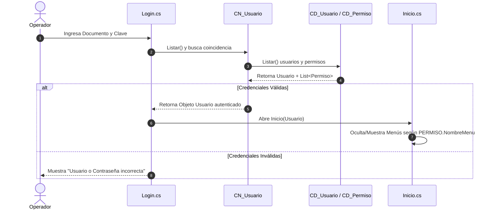
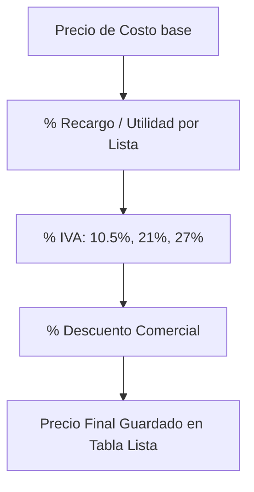
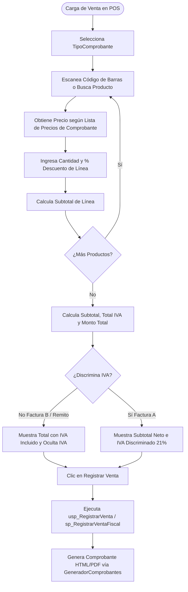

# 02. Reconstrucción de Módulos y Flujos Operativos
## Análisis Funcional y Flujos de Trabajo - JC Distribuciones

---

## 1. Módulo de Autenticación, Usuarios, Roles y Permisos

### 1.1 Propósito
Garantizar la seguridad de acceso al sistema, autenticar operadores y restringir la visibilidad de los módulos del menú principal en función de la matriz de permisos configurada por rol.

### 1.2 Componentes e Interfaz
- **Pantallas**: `Login.cs`, `Inicio.cs`, `frmUsuarios.cs`.
- **Entidades / Tablas**: `USUARIO`, `ROL`, `PERMISO` (Desarrollo) / `regusuarios` (Producción).

### 1.3 Matriz de Análisis Funcional
- **Validaciones**: Se exige documento no vacío y coincidencia exacta de contraseña. `SP_REGISTRARUSUARIO` valida que no se repita el número de documento ([QueryResumen.txt:L175](file:///c:/jcdistribuciones/jcdistribuciones/QuerySQL/QueryResumen.txt#L175)).
- **Estados**: Flag booleano `Estado` (`1=Activo`, `0=Inactivo`).
- **Permisos**: Los menús del WinForms (`menuusuarios`, `menumantenedor`, `menuventas`, `menucompras`, `menuclientes`, `menuproveedores`, `menureportes`, `menuacercade`) se habilitan por coincidencia exacta con `PERMISO.NombreMenu` ([Inicio.cs:L70-L95](file:///c:/jcdistribuciones/jcdistribuciones/CapaPresentacion/Inicio.cs#L70-L95)).
- **Problemas / Deuda Técnica**:
  - **CONFIRMADO**: Las contraseñas se almacenan en **texto plano** en la columna `Clave` de la tabla `USUARIO` ([QueryResumen.txt:L54](file:///c:/jcdistribuciones/jcdistribuciones/QuerySQL/QueryResumen.txt#L54)).
  - **NO IMPLEMENTADO**: En `modulos.xlsx` se indica el pendiente *"falta codificar la contraseña"*.

---

## 2. Módulo de Clientes, Proveedores y Vendedores

### 2.1 Propósito
Administrar el catálogo de entidades comerciales (compradores, vendedores y proveedores), sus datos de localización (Provincias, Localidades, Zonas) y atributos impositivos (Condición IVA, CUIT/DNI).

### 2.2 Componentes e Interfaz
- **Pantallas**: `frmClientes.cs`, `frmProveedores.cs`, `Modales/mdCliente.cs`, `Modales/mdProveedor.cs`.
- **Entidades / Tablas**: `CLIENTE`, `PROVEEDOR`, `Zona`, `Localidad`, `Provincia` (Desarrollo) / `cliente`, `proveedor`, `vendedor`, `zona`, `localidad`, `provincia`, `pais`, `codigo_iva`, `tipo_dni` (Producción).

### 2.3 Matriz de Análisis Funcional
- **Validaciones**:
  - `sp_RegistrarCliente`: Valida unicidad de `Dni` / `Cuit` ([script_clientes.sql:L60](file:///c:/jcdistribuciones/jcdistribuciones/QuerySQL/script_clientes.sql#L60)).
  - `sp_EliminarProveedor`: Bloquea la eliminación física si existen compras asociadas en la tabla `COMPRA` ([QueryResumen.txt:L569](file:///c:/jcdistribuciones/jcdistribuciones/QuerySQL/QueryResumen.txt#L569)).
- **Diferencias Críticas Desarrollo vs Producción**:
  - **CONFIRMADO**: En **Producción**, la tabla `cliente` posee **25 columnas**, incluyendo relación directa con `Id_vendedor`, `Id_Zona`, `Id_Codigo_Iva` y campos de Cuenta Corriente (`MovimientoCtaCte`). En **Desarrollo**, la tabla `CLIENTE` inicial solo tenía 6 campos básicos ([QueryResumen.txt:L37](file:///c:/jcdistribuciones/jcdistribuciones/QuerySQL/QueryResumen.txt#L37)), requiriendo la ejecución de `script_clientes.sql` para expandirla.

---

## 3. Módulo de Artículos, Categorías, Listas de Precios e IVA

### 3.1 Propósito
Gestión integral del catálogo de artículos, códigos de barra, alícuotas de IVA y esquema de múltiples listas de precios (Mayorista, Minorista, Promoción) basadas en la calculadora de costos.

### 3.2 Componentes e Interfaz
- **Pantallas**: `frmProducto.cs`, `Modales/mdPreciosLista.cs`, `Modales/mdProducto.cs`.
- **Entidades / Tablas**: `PRODUCTO`, `CATEGORIA`, `IVA`, `Lista` (Desarrollo) / `articulo`, `rubro`, `iva`, `tipolistas`, `Lista` (Producción).

### 3.3 Matriz de Análisis Funcional
- **Cálculos de Formación de Precios**:
  - Implementado en `CN_Lista.CalcularPrecioVenta()` ([CN_Lista.cs:L44-L56](file:///c:/jcdistribuciones/jcdistribuciones/CapaNegocio/CN_Lista.cs#L44-L56)):
    1. $\text{PrecioConRecargo} = \text{Costo} \times (1 + \frac{\text{Recargo}}{100})$
    2. $\text{PrecioConIVA} = \text{PrecioConRecargo} \times (1 + \frac{\text{IVA}}{100})$
    3. $\text{PrecioFinal} = \text{PrecioConIVA} \times (1 - \frac{\text{Descuento}}{100})$
- **Actualización de Precios Históricos**:
  - **INCONSISTENTE / RIESGO**: Al modificar un valor en la tabla `Lista`, los precios vigentes cambian instantáneamente para nuevos comprobantes. Los comprobantes emitidos previamente conservan su valor histórico en `DETALLE_VENTA.PrecioVenta`.

---

## 4. Módulo de Ventas Fiscales, Facturación y Remitos

### 4.1 Propósito
Emisión interactiva de comprobantes comerciales y fiscales (Facturas A, Facturas B, Recibos y Remitos), con discriminación o inclusión de IVA, descuento de existencias y generación de tickets/HTML.

### 4.2 Componentes e Interfaz
- **Pantallas**: `frmVentasFiscales.cs`, `frmVentas.cs`, `frmDetalleVenta.cs`.
- **Entidades / Tablas**: `VENTA`, `DETALLE_VENTA`, `TipoComprobante` (Desarrollo) / `comprobante`, `detallecomprobante`, `tipocomprobante` (Producción).

### 4.3 Matriz de Análisis Funcional
- **Regla de Discriminación de IVA**:
  - Configurada mediante `TipoComprobante.DiscriminaIVA` ([crear_tablas_ventas_fiscales.sql:L21](file:///c:/jcdistribuciones/jcdistribuciones/QuerySQL/crear_tablas_ventas_fiscales.sql#L21)):
    - **Factura A (`FA`)**: `DiscriminaIVA = 1` -> Muestra Subtotal Neto, IVA 21% y Total.
    - **Factura B (`FB`)**: `DiscriminaIVA = 0` -> Oculta desglose de IVA; los precios exhibidos contienen el impuesto embebido.
    - **Remito (`REC` / `REMITO`)**: `DiscriminaIVA = 0` -> No aplica IVA fiscal (`totalIVA = 0`).
- **Descuento de Stock**:
  - Al procesar la venta, se valida si `PRODUCTO.ControlaStock = 1`. En caso afirmativo, la transacción ejecuta el descuento automático de stock en base de datos.

---

## 5. Módulo de Devoluciones y Notas de Crédito (NCA / NCB)

### 5.1 Propósito
Gestión de devoluciones parciales o totales de mercadería vendida previamente, emitiendo la correspondiente Nota de Crédito fiscal (NCA o NCB) y restituyendo las unidades al inventario físico.

### 5.2 Componentes e Interfaz
- **Pantallas**: `frmDevolucionesCliente.cs`, `frmDevoluciones.cs`.
- **Entidades / Tablas**: `VENTA`, `DETALLE_VENTA`, `TipoComprobante` (Desarrollo) / `comprobante`, `detallecomprobante`, `Comprobante_Asociado` (Producción).

### 5.3 Matriz de Análisis Funcional
- **Validaciones**:
  - `ValidarCantidadesDevolucion()`: Verifica que la cantidad devuelta no supere la cantidad vendida originalmente ([CN_Venta_Extensiones.cs:L287-L319](file:///c:/jcdistribuciones/jcdistribuciones/CapaNegocio/CN_Venta_Extensiones.cs#L287-L319)).
  - Bloquea la emisión de una Nota de Crédito a partir de otra Nota de Crédito ([CN_Venta_Extensiones.cs:L47](file:///c:/jcdistribuciones/jcdistribuciones/CapaNegocio/CN_Venta_Extensiones.cs#L47)).
- **Reingreso a Stock**:
  - El procedimiento `sp_RegistrarNotaCredito` suma la cantidad devuelta al stock del producto (`Stock = Stock + Cantidad`).

---

## 6. Módulo de Pedidos y Pre-Venta (Crítico en Producción)

### 6.1 Propósito y Estado
- **En Producción**: Módulo vital donde los vendedores toman pedidos a clientes (`pedido`, `detallepedido`, `tmp_pedido`), los cuales pasan por estados (`Pendiente`, `Preparado`, `Facturado`) antes de convertirse en comprobantes definitivos.
- **En Desarrollo**: **NO IMPLEMENTADO**. El proyecto .NET de desarrollo no posee formularios ni clases para la gestión del flujo de pedidos pre-venta.

---

## 7. Módulo de Cuenta Corriente y Caja (Crítico en Producción)

### 7.1 Propósito y Estado
- **En Producción**: Administra la deuda de clientes (`MovimientoCtaCte`), pagos parciales (`DetalleMovimientoCtaCte`), saldo adeudado, cierres de caja diaria (`caja`, `detallecaja`) y conceptos de gastos (`concepto_caja`).
- **En Desarrollo**: **NO IMPLEMENTADO**. Ausente en la solución .NET de desarrollo.

---

## 8. Módulo de Reportes, Exportaciones e Impresión

### 8.1 Propósito
Generar informes de ventas y compras filtrados por rango de fechas, clientes/proveedores, exportar las grillas a archivos Excel (`.xlsx`) y renderizar tickets de venta.

### 8.2 Componentes e Interfaz
- **Pantallas**: `frmReporteVentas.cs`, `frmReporteCompras.cs`, `frmReportes.cs`.
- **Lógica de Generación de Tickets**: `GeneradorComprobantes.cs` reemplaza tokens (`@NUMERO`, `@CLIENTE`, `@TOTAL`, etc.) en plantillas HTML (`PlantillaVenta.html`, `PlantillaCompra.html`) ubicadas en `Resources/`.
