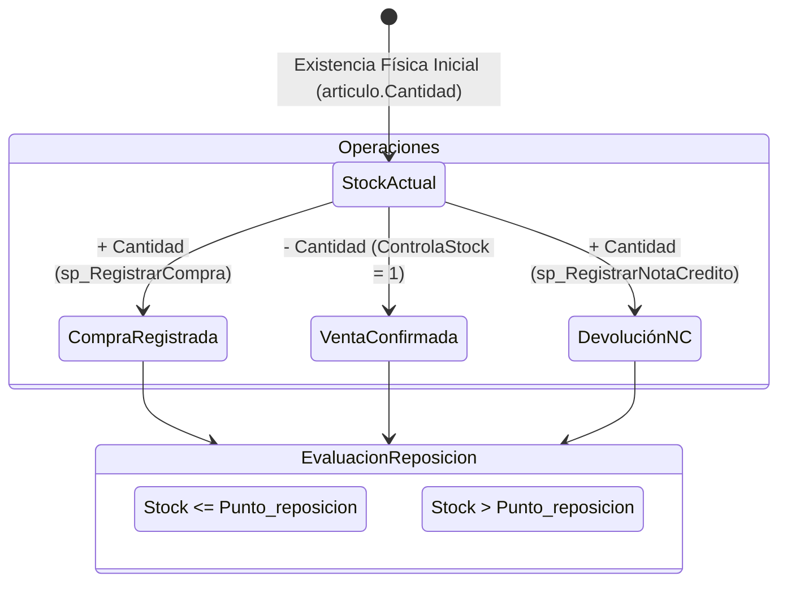

# 05. Especificación de Reglas de Negocio, Cálculos y Control de Stock
## Consolidación de Algoritmos Financieros y Reglas Operativas

---

## 1. Algoritmos de Formación de Precios de Venta

### 1.1 Fórmula Matemática de Lista de Precios
En la capa de negocio ([CN_Lista.cs:L44-L56](file:///c:/jcdistribuciones/jcdistribuciones/CapaNegocio/CN_Lista.cs#L44-L56)), el precio de venta final de un producto para una lista determinada (Mayorista, Minorista, Promoción) se calcula a partir del precio de costo aplicando la siguiente secuencia ordenada:

$$ \text{PrecioFinal} = \left[ \left( \text{Costo} \times \left(1 + \frac{\text{Recargo}}{100}\right) \right) \times \left(1 + \frac{\text{IVA}}{100}\right) \right] \times \left(1 - \frac{\text{Descuento}}{100}\right) $$

### 1.2 Tabla de Especificación por Etapa

| Orden | Etapa / Operación | Fórmula Aplicada | Escala / Redondeo | Ubicación en Código |
| :--- | :--- | :--- | :--- | :--- |
| **1** | **Costo Base** | $\text{Costo}$ (obtenido de `PRODUCTO.PrecioCompra` o `articulo.Costo`) | Decimal (10,2) | `CN_Lista.cs:L47` |
| **2** | **Aplicación de Recargo**| $\text{PrecioRecargo} = \text{Costo} + (\text{Costo} \times \frac{\% \text{Recargo}}{100})$ | Decimal Intermedio | `CN_Lista.cs:L47` |
| **3** | **Aplicación de IVA** | $\text{PrecioIVA} = \text{PrecioRecargo} + (\text{PrecioRecargo} \times \frac{\% \text{IVA}}{100})$ | Decimal Intermedio | `CN_Lista.cs:L50` |
| **4** | **Aplicación de Descuento**| $\text{PrecioFinal} = \text{PrecioIVA} - (\text{PrecioIVA} \times \frac{\% \text{Descuento}}{100})$ | Decimal Intermedio | `CN_Lista.cs:L53` |
| **5** | **Redondeo Final** | $\text{ImporteFinal} = \text{Math.Round}(\text{PrecioFinal}, 2)$ | **2 Decimales** | `CN_Lista.cs:L55` |

---

### 1.3 Ejemplo Numérico Completo
Dado: $\text{Costo} = \$ 2.500,00$, $\text{Recargo} = 40\%$, $\text{IVA} = 21\%$, $\text{Descuento} = 10\%$
1. $\text{PrecioRecargo} = 2.500 \times 1.40 = \$ 3.500,00$
2. $\text{PrecioIVA} = 3.500 \times 1.21 = \$ 4.235,00$
3. $\text{PrecioFinal} = 4.235 \times 0.90 = \$ 3.811,50$
$$\mathbf{\text{Importe Final Guardado}} = \$ 3.811,50$$

---

## 2. Cálculos en Ventas Fiscales y Comprobantes

### 2.1 Fórmulas por Renglón (Línea de Detalle)
En [frmVentasFiscales.cs:L365-L375](file:///c:/jcdistribuciones/jcdistribuciones/CapaPresentacion/frmVentasFiscales.cs#L365-L375):
- $\text{SubtotalBruto}_i = P_i \times Q_i$
- $\text{ImporteDescuento}_i = \text{SubtotalBruto}_i \times \left( \frac{\text{PorcDesc}_i}{100} \right)$
- $\text{SubtotalNeto}_i = \text{SubtotalBruto}_i - \text{ImporteDescuento}_i$

### 2.2 Fórmulas de Totales del Comprobante
En [frmVentasFiscales.cs:L454-L538](file:///c:/jcdistribuciones/jcdistribuciones/CapaPresentacion/frmVentasFiscales.cs#L454-L538):
- $\text{NetoTotal} = \sum_{i=1}^{N} \text{SubtotalNeto}_i$
- $\text{TotalDescuentos} = \sum_{i=1}^{N} \text{ImporteDescuento}_i$

#### Discriminación de IVA según TipoComprobante:
- **Factura A (`FA` - `DiscriminaIVA = 1`)**:
  - $\text{TotalIVA} = \text{NetoTotal} \times 0,21$
  - $\text{MontoTotal} = \text{NetoTotal} + \text{TotalIVA}$
  - Muestra en pantalla $\text{txtSubTotal}$, $\text{txtTotalIVA}$ y $\text{txtTotal}$.
- **Factura B / Recibo (`FB` / `REC` - `DiscriminaIVA = 0`)**:
  - $\text{TotalIVA} = 0,00$ (El IVA está incluido en el precio unitario $P_i$).
  - $\text{MontoTotal} = \text{NetoTotal}$
  - Oculta $\text{txtTotalIVA}$ en pantalla.

---

## 3. Matriz de Control de Riesgos Fórmulas e Inconsistencias

| Riesgo Evaluado | Estado | Evidencia y Explicación Técnica | Recomendación para Django |
| :--- | :--- | :--- | :--- |
| **1. Aplicar IVA dos veces** | **CONFIRMADO** (Riesgo Presente) | En `mdPreciosLista.cs`, se calcula el precio final con IVA incluido y se guarda en `Lista.Importe`. Si luego en `frmVentasFiscales.cs` se selecciona Factura A y se vuelve a aplicar el 21% sobre el precio de lista, se duplica el IVA. | Mantener los precios base en la BD estrictamente como **Netos Gravados sin IVA**. |
| **2. IVA hardcoded al 21%** | **CONFIRMADO** (Inconsistencia) | `frmVentasFiscales.cs:L512` calcula `totalIVA = netoTotal * 0.21m` de forma global para todo el comprobante, ignorando si hay productos con IVA 10.5% o 27%. | Sumar el IVA discriminado por renglón $\sum \text{ImporteIVA}_i$. |
| **3. Redondeo Discrepante** | **CONFIRMADO** (Riesgo Presente) | En C# se redondea por renglón a 2 decimales (`ToString("0.00")`) y luego se suman los strings convertidos a decimal, mientras que SQL Server realiza operaciones con la precisión completa del tipo de columna. | Implementar redondeo monetario estandarizado `ROUND(..., 2)` en Django Services. |
| **4. Duplicación de Descuento de Stock (Factura vs Remito)** | **CONFIRMADO** (Riesgo Operativo) | En la base de datos de producción, tanto `PA_INS_Facturas` como el registro de remitos ejecutan `UPDATE articulo SET Cantidad = Cantidad - ...`. Si un remito se factura posteriormente, se descuenta el stock dos veces. | Separar la **Reserva/Despacho de Stock** de la **Emisión Fiscal del Comprobante**. |
| **5. Devolución de Cantidad Superior a la Vendida** | **CONTROLADO** | `CN_Venta_Extensiones.cs:L287` valida `itemDevolucion.Cantidad <= itemOriginal.Cantidad`, impidiendo devolver más unidades de las facturadas. | Preservar esta regla en el servicio `NotaCreditoService` de Django. |
| **6. Modificación de Precios Históricos** | **CONTROLADO** | Al modificar la tabla `Lista`, el precio cambia para el catálogo, pero los comprobantes históricos almacenados en `DETALLE_VENTA` / `detallecomprobante` conservan el valor pactado al momento de la venta. | Asegurar que los modelos `DetalleComprobante` de Django copien los precios unitarios de forma inmutable. |

---

## 4. Reglas de Balance e Impacto en Inventario (Stock)

### 4.1 Reglas del Ciclo de Stock
1. **Compras (`sp_RegistrarCompra`)**:
   - Incrementa existencias: $\text{Stock}_{\text{nuevo}} = \text{Stock}_{\text{actual}} + \text{CantidadComprada}$.
   - Actualiza automáticamente el costo base: $\text{PrecioCompra} = \text{PrecioCompraComprado}$.
2. **Ventas (`usp_RegistrarVenta` / `sp_RegistrarVentaFiscal`)**:
   - Si `PRODUCTO.ControlaStock = 1`, descuenta existencias: $\text{Stock}_{\text{nuevo}} = \text{Stock}_{\text{actual}} - \text{CantidadVendida}$.
   - Si `ControlaStock = 0`, no modifica existencias.
3. **Devoluciones por Nota de Crédito (`sp_RegistrarNotaCredito`)**:
   - Restituye existencias al inventario: $\text{Stock}_{\text{nuevo}} = \text{Stock}_{\text{actual}} + \text{CantidadDevuelta}$.
4. **Alerta por Punto de Reposición**:
   - Si $\text{Stock} \le \text{Punto\_reposicion}$, el producto se marca visualmente en amarillo/rojo en las grillas de consulta para su reorden.
