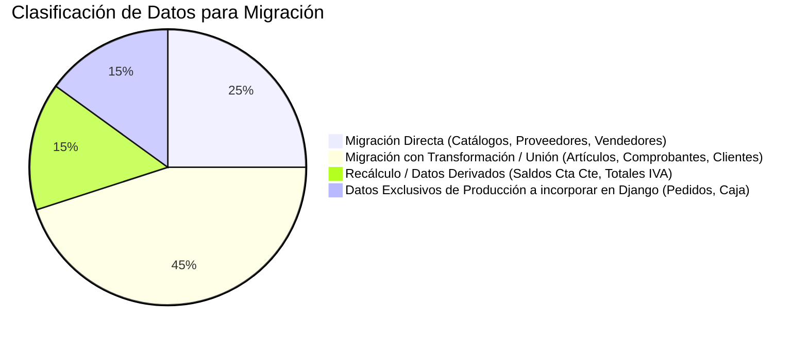

# 06. Matriz de Correspondencia: Desarrollo vs Producción
## Comparación Estructural y Diagnóstico de Compatibilidad de Datos

---

## 1. Matriz de Correspondencia Entidad por Entidad

| Dominio | Entidad de Desarrollo | Tabla Productiva Candidata | Coincidencia | Diferencias Identificadas | Transformación Necesaria | Nivel de Riesgo |
| :--- | :--- | :--- | :--- | :--- | :--- | :--- |
| **Usuarios** | `USUARIO` | `regusuarios` | **Parcial** | Dev usa `Documento`, `NombreCompleto`, `Clave`. Prod usa `usuarioid`, `nombreusuario`, `contrase`. | Mapear columnas de credenciales y migrar passwords (convertir a Hash). | **MEDIO** |
| **Roles / Permisos** | `ROL` / `PERMISO` | No existe en Prod (Hardcoded en VB6/Legacy) | **Sin equivalente** | Desarrollo usa matriz dinámica `PERMISO`. Producción no tiene tabla de permisos. | Generar datos semilla de permisos en Django a partir de los roles actuales. | **BAJO** |
| **Clientes** | `CLIENTE` | `cliente` / `cliente2` | **Varios a Uno** | Prod tiene `cliente` y backup `cliente2` con 25 columnas (Cta. Cte., Vendedor, Zona). Dev tiene 18 campos. | Consolidar `cliente` + `cliente2`, unificar IDs y mapear claves de localización (`zona`, `localidad`). | **ALTO** |
| **Vendedores** | `Vendedor` (en `src/SQL`) | `vendedor` | **Directa** | Estructuras casi idénticas (DNI, Nombre, Apellido, Comisiones). | Migración directa de filas sanitizando tipos enteros de DNI/Teléfono. | **BAJO** |
| **Proveedores** | `PROVEEDOR` | `proveedor` | **Directa** | Prod usa `Id_proveedor`, `RazonSocial`, `Cuit`. Dev usa `PROVEEDOR` con esquema idéntico. | Migración directa de proveedores activos. | **BAJO** |
| **Artículos / Productos** | `PRODUCTO` | `articulo` / `articulo1` / `articulo2` | **Varios a Uno** | Prod posee 3 tablas fragmentadas (`articulo`, `articulo1`, `articulo2`). `articulo.Costo` es `DECIMAL(6,2)`. | **UNION ALL** de las 3 tablas, deduplicación por `Cod_articulo` y ampliación de tipo decimal. | **CRÍTICO** |
| **Categorías / Rubros** | `CATEGORIA` | `rubro` | **Parcial** | Dev llama `CATEGORIA(Descripcion)`. Prod llama `rubro(Descripcin)`. | Mapear `id_Rubro -> id_categoria` y corregir encoding de texto (UTF-8). | **BAJO** |
| **Alícuotas de IVA** | `IVA` | `iva` / `codigo_iva` | **Parcial** | Prod tiene `iva` (valores) y `codigo_iva` (descripciones). Dev integró tabla `IVA`. | Unificar en modelo `AlicuotaIVA` en Django. | **BAJO** |
| **Listas de Precios** | `Lista` | `tipolistas` / `Lista` / `Lista1` / `Lista2` | **Varios a Uno** | Prod posee múltiples tablas `Lista1`, `Lista2` por categoría. Dev integró tabla `Lista` con campo `id_Tipolistas`. | Consolidar registros de `Lista1` y `Lista2` en una única tabla relacional con `id_tipolista`. | **ALTO** |
| **Comprobantes / Ventas**| `VENTA` | `comprobante` / `comprobante1` / `comprobante2` / `comprobante_anterior` | **Varios a Uno** | Prod dividió las facturas históricas en 4 tablas. Dev tiene una sola tabla `VENTA`. | **UNION ALL** masivo de las 4 tablas de comprobantes, preservando `Id_Comprobante` original. | **CRÍTICO** |
| **Detalle de Ventas** | `DETALLE_VENTA` | `detallecomprobante` / `detallecomprobante1` / `detallecomprobante2` / `detallecomprobante_ant` | **Varios a Uno** | Prod tiene 4 tablas de detalles acopladas a las facturas. `Precio_Unitario` es `DECIMAL(6,2)`. | **UNION ALL** de detalles, re-vinculación con comprobantes consolidados y casting de precios. | **CRÍTICO** |
| **Pedidos Pre-Venta** | No existe en Dev | `pedido` / `detallepedido` / `tmp_pedido` / `Pedido_Seleccionado` | **Sin equivalente** | Implementado en Prod; completamente omitido en el proyecto .NET de desarrollo. | Crear modelos `Pedido` y `DetallePedido` en Django e importar histórico de producción. | **ALTO** |
| **Cuenta Corriente** | No existe en Dev | `MovimientoCtaCte` / `DetalleMovimientoCtaCte` / `Comprobantes_Impagos` | **Sin equivalente** | Módulo de saldos y cobros a clientes de Prod. Inexistente en desarrollo. | Diseñar módulo de Cta. Cte. en Django e importar saldos iniciales de producción. | **CRÍTICO** |
| **Caja Diaria** | No existe en Dev | `caja` / `detallecaja` / `concepto_caja` | **Sin equivalente** | Arqueo de caja y movimientos de dinero en Prod. Inexistente en desarrollo. | Diseñar modelo `Caja` en Django para cierre diario y control de efectivo. | **MEDIO** |

---

## 2. Clasificación de la Información para la Migración a PostgreSQL

### 2.1 Información que puede migrarse directamente
- Tabla `proveedor` $\rightarrow$ Modelo `Proveedor` (Django).
- Tabla `vendedor` $\rightarrow$ Modelo `Vendedor` (Django).
- Tablas `provincia`, `localidad`, `pais`, `zona` $\rightarrow$ Modelos de Geografía.
- Tabla `codigo_iva` $\rightarrow$ Catálogo de Condiciones IVA (AFIP).

### 2.2 Información que requiere transformación y consolidación (ETL)
- **Artículos**: Unificar `articulo UNION ALL articulo1 UNION ALL articulo2`, deduplicando por `Cod_articulo`.
- **Clientes**: Unificar `cliente UNION ALL cliente2`, seleccionando el registro más reciente por DNI/CUIT.
- **Comprobantes de Ventas**: Unificar `comprobante UNION ALL comprobante1 UNION ALL comprobante2 UNION ALL comprobante_anterior`, normalizando nro. de documento y cliente.
- **Detalle de Comprobantes**: Unificar `detallecomprobante UNION ALL detallecomprobante1 UNION ALL detallecomprobante2 UNION ALL detallecomprobante_ant`.
- **Listas de Precios**: Consolidar `Lista UNION ALL Lista1 UNION ALL Lista2`.

### 2.3 Información que debe recalcularse
- **Saldos de Cuenta Corriente**: Los saldos actuales de los clientes deben verificarse recalculando el libro mayor: $\text{SaldoCalculado} = \sum \text{FacturasImpagas} - \sum \text{RecibosCobro}$.
- **Totales de IVA Discriminado**: En facturas B históricas donde el IVA no fue discriminado, se debe realizar el desglose inverso: $\text{Neto} = \frac{\text{Total}}{1.21}$, $\text{IVA} = \text{Total} - \text{Neto}$.

### 2.4 Información existente en Producción pero NO contemplada en Desarrollo
- Histórico completo de **Pedidos pre-venta** (`pedido`, `detallepedido`).
- Libro de **Movimientos de Cuenta Corriente** (`MovimientoCtaCte`, `DetalleMovimientoCtaCte`).
- Arqueos de **Caja Diaria** (`caja`, `detallecaja`, `concepto_caja`).
- Comprobantes impagos y cobranzas (`Comprobantes_Impagos`, `Comprobante_Asociado`).

### 2.5 Información Imposible de Migrar sin Decisión del Usuario
- **Contraseñas de Usuarios (`regusuarios.contrase`)**: Dado que están almacenadas en texto plano o con algoritmos obsoletos en producción, no pueden transferirse directamente al sistema de hashing de Django (`PBKDF2` / `BCrypt`). Se requiere forzar un blanqueo/reseteo de clave en el primer ingreso.
- **Registros Huérfanos sin Cliente (`comprobante.id_cliente` inexistente)**: Comprobantes históricos cuyo ID de cliente fue eliminado físicamente en producción deberán asignarse a un cliente genérico ficticio (`CONSUMIDOR FINAL ANÓNIMO`).
