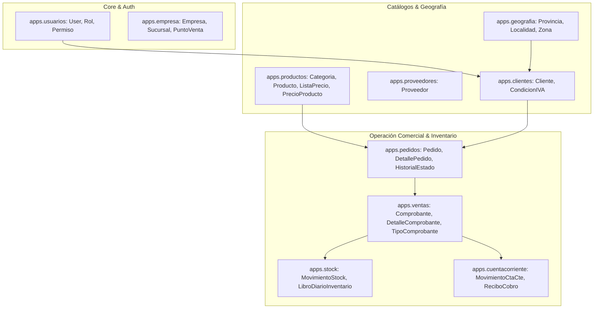

# 08. Propuesta de Modelo Conceptual y Arquitectura Django / PostgreSQL
## Diseño Orientado al Dominio para el Futuro Sistema Web

---

## 1. Mapeo de Tipos de Datos: SQL Server $\rightarrow$ PostgreSQL / Django ORM

Tabla de conversión estandarizada basada estrictamente en los tipos encontrados en el script de producción (`script sp produccion.sql`):

| Tipo en SQL Server | Tipo en PostgreSQL | Campo Django ORM (`models.*`) | Reglas de Conversión / Consideraciones |
| :--- | :--- | :--- | :--- |
| `INT IDENTITY(1,1)` | `BIGSERIAL` / `INTEGER` | `models.BigAutoField(primary_key=True)` | Conservar los IDs primarios históricos durante el ETL. |
| `VARCHAR(N)` | `VARCHAR(N)` | `models.CharField(max_length=N)` | Usar `db_index=True` en códigos de barra y documentos. |
| `VARCHAR(MAX)` | `TEXT` | `models.TextField()` | Adecuado para comentarios u observaciones extendidas. |
| `DECIMAL(6,2)` / `(10,2)`| `NUMERIC(14,2)` | `models.DecimalField(max_digits=14, decimal_places=2)` | **Ampliación obligatoria** para evitar overflow monetario. |
| `DECIMAL(10,8)` | `NUMERIC(12,8)` | `models.DecimalField(max_digits=12, decimal_places=8)` | Para geolocalización de clientes (`Latitud`, `Longitud`). |
| `BIT` | `BOOLEAN` | `models.BooleanField(default=True)` | Mapeo `1 -> True`, `0 -> False`. |
| `DATETIME` | `TIMESTAMPTZ` | `models.DateTimeField()` | Almacenamiento UTC con zona horaria `America/Argentina/Buenos_Aires`. |
| `VARBINARY(MAX)` | `BYTEA` | `models.BinaryField()` / `models.ImageField()` | Migrar imágenes de logo a storage estático (`S3` / `Media`). |

---

## 2. Arquitectura Modular en Django (Apps)



---

## 3. Especificación de Dominios y Modelos Candidates

### 3.1 App `productos` (Catálogo y Precios)
- **Modelos**:
  - `Categoria`: `nombre`, `descripcion`, `estado`.
  - `Producto`: `codigo`, `codigo_barras`, `nombre`, `descripcion`, `categoria`, `costo_base`, `stock_actual`, `punto_reposicion`, `controla_stock`, `activo`.
  - `TipoListaPrecio`: `nombre` (Mayorista, Minorista, Promoción), `es_activa`.
  - `PrecioProducto`: `producto` (FK), `tipo_lista` (FK), `porcentaje_recargo`, `porcentaje_iva`, `porcentaje_descuento`, `precio_final`.
- **Copia Histórica Inmutable**: Los comprobantes de venta no apuntan al precio dinámico de `PrecioProducto`, sino que copian el `precio_unitario` acordado al momento de la venta.

### 3.2 App `pedidos` (Flujo Pre-Venta)
- **Modelos**:
  - `Pedido`: `numero_pedido`, `cliente` (FK), `vendedor` (FK), `fecha_pedido`, `estado` (`PENDIENTE`, `APROBADO`, `PREPARADO`, `FACTURADO`, `CANCELADO`), `monto_subtotal`, `monto_total`.
  - `DetallePedido`: `pedido` (FK), `producto` (FK), `cantidad`, `precio_unitario`, `subtotal`.
- **Concurrencia / Atomicidad**:
  - El cambio de estado a `APROBADO` o `FACTURADO` se ejecuta dentro de un bloque `transaction.atomic()`.

### 3.3 App `ventas` (Facturación Fiscal y Remitos)
- **Modelos**:
  - `TipoComprobante`: `codigo` (`FA`, `FB`, `REC`, `NCA`, `NCB`), `descripcion`, `discrimina_iva`, `es_nota_credito`.
  - `Comprobante`: `tipo_comprobante` (FK), `punto_venta`, `numero_documento`, `cliente` (FK), `vendedor` (FK), `fecha_emision`, `subtotal_neto`, `total_iva`, `total_descuento`, `monto_total`, `cae_afip`, `vencimiento_cae`.
  - `DetalleComprobante`: `comprobante` (FK), `producto` (FK), `codigo_producto_historico`, `nombre_producto_historico`, `cantidad`, `precio_unitario`, `alicuota_iva`, `subtotal`.

### 3.4 App `stock` (Libro Mayor de Inventario - Audit Trail)
- **Concepto**: En lugar de modificar únicamente un entero `stock_actual`, toda alteración de existencias se registra como un evento inmutable en un **Libro de Movimientos de Stock**:
  - `MovimientoStock`: `fecha`, `producto` (FK), `tipo_movimiento` (`ENTRADA_COMPRA`, `SALIDA_VENTA`, `DEVOLUCION_NC`, `AJUSTE_INVENTARIO`), `cantidad` (Positiva/Negativa), `stock_resultante`, `comprobante_asociado` (FK opcional), `usuario` (FK).

---

## 4. Requerimientos Técnicos y Estrategia PostgreSQL

1. **Búsqueda Búsqueda de Productos y Clientes**:
   - Para soportar búsqueda insensible a mayúsculas y acentos sin degradación de rendimiento, activar la extensión `citext` o crear un índice `trigram` con `pg_trgm`:
     ```sql
     CREATE EXTENSION IF NOT EXISTS pg_trgm;
     CREATE INDEX idx_producto_nombre_trgm ON productos_producto USING gin (nombre gin_trgm_ops);
     ```
2. **Numeración de Comprobantes Libre de Colisiones**:
   - Utilizar secuencias nativas de PostgreSQL o cerrojo pesimista `select_for_update()` sobre una tabla de numeradores `PuntoVentaNumerador`.
3. **Procesos Celery (Tareas Asíncronas)**:
   - **Autorización Fiscal AFIP / ARCA**: La llamada HTTP a los Web Services de la AFIP para obtener CAE se ejecuta de forma asíncrona mediante tareas Celery / Redis, evitando bloquear el hilo del servidor web.
   - **Generación de PDFs y Envíos de Emails**: Renderizado de comprobantes A4 y envío de facturas por correo en segundo plano.
