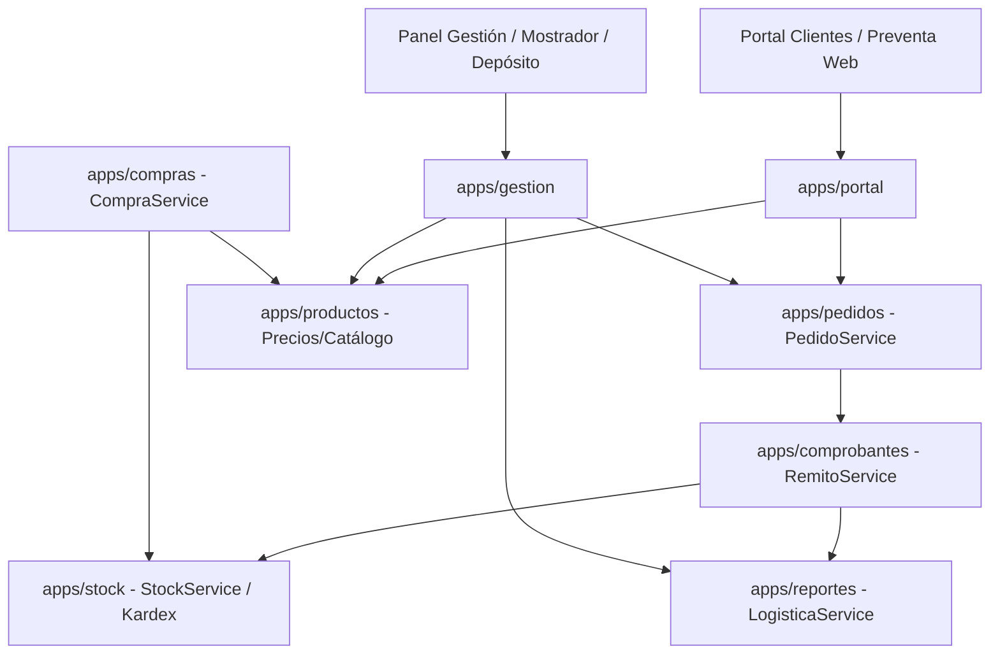

# INFORME DE AUDITORÍA TÉCNICA Y FUNCIONAL
## Sistema de Gestión Comercial y Distribución — JC Distribuciones

**Fecha:** 21 de Octubre de 2026  
**Auditor:** Agente Auditor Técnico y Funcional (DeepMind Antigravity)  
**Destinatario:** ChatGPT (Coordinador Técnico y de Desarrollo) / Responsable del Proyecto  
**Repositorio / Directorio:** `C:\jcdistribuciones`  
**Objetivo:** Diagnóstico exhaustivo del estado técnico, funcional, de arquitectura, base de datos y despliegue del sistema web Django + PostgreSQL para distribuidora de alimentos con destino a VPS Linux.

---

## 1. Resumen Ejecutivo

1. **Naturaleza del Sistema y Estado Global:**  
   El sistema es una solución web comercial B2B para una distribuidora mayorista de alimentos (**JC Distribuciones**). El repositorio contiene un backend Django moderno con 12 aplicaciones modulares organizadas en `apps/`, interfaz de portal de clientes, gestión de supervisión/depósito y un conjunto de servicios de dominio para pedidos, remitos A4 y control de inventario (Kardex).
2. **Criterio de Realidad Operativa:**  
   Aunque el avance a nivel de lógica de backend es notable (40 tests automatizados ejecutados y aprobados al 100%), el sistema **NO está listo para producción en VPS**. Existen bloqueos de configuración e infraestructura de severidad crítica: la base de datos está hardcodeada a SQLite en `config/settings/base.py`, no se leen variables de entorno para PostgreSQL, no está incluido Gunicorn ni servidor WSGI de producción en `requirements.txt`, no existen scripts ni archivos de despliegue (Nginx/systemd), y el directorio de trabajo **no está inicializado como repositorio Git**.
3. **Alineación con el Negocio Mayorista de Alimentos:**  
   - **Puntos Fuertes:** Los flujos de aprobación de pedidos, congelamiento histórico de precios, remito A4 comercial sin IVA discriminado, y la diferenciación estricta entre faltante de despacho (`NCF`, sin reingreso a stock) y devolución (`NC`, con reingreso configurable a stock) están sólidamente modelados en servicios transaccionales protegidos por bloqueos pesimistas (`select_for_update`).
   - **Brechas Críticas para el Rubro Alimentos:** Todas las cantidades (`cantidad`, `stock_actual`, `factor_conversion`) están tipadas como enteros (`IntegerField`), imposibilitando la venta o pesaje fraccionado (kilos, gramos). No existen entidades ni campos para **Lotes**, **Fechas de Vencimiento**, ni trazabilidad sanitaria/cadena de frío.
   - **Módulos Pendientes del Negocio:** Cuenta corriente / cobranzas (solo existe un saldo inicial estático en clientes), facturación electrónica ARCA (AFIP) y el proceso de migración de datos desde el script productivo SQL Server.

---

## 2. Identificación del Proyecto y Estado Git

| Atributo | Detalle Observado | Evidencia / Ruta |
| :--- | :--- | :--- |
| **Nombre del Sistema** | Sistema Comercial Mayorista — JC Distribuciones | [Plan_Maestro_Migracion_JC_Distribuciones_Django.md](file:///c:/jcdistribuciones/Plan_Maestro_Migracion_JC_Distribuciones_Django.md#L3) |
| **Propósito** | Reemplazo web del software de escritorio productivo; gestión de preventa móvil, portal B2B mayorista, aprobación de pedidos, remitos A4 y stock. | [Plan_Maestro_Migracion_JC_Distribuciones_Django.md](file:///c:/jcdistribuciones/Plan_Maestro_Migracion_JC_Distribuciones_Django.md#L11-L26) |
| **Ruta Raíz** | `C:\jcdistribuciones` | Entorno de trabajo local |
| **Punto de Entrada Django** | `manage.py` en la raíz (`C:\jcdistribuciones\manage.py`) | [manage.py](file:///c:/jcdistribuciones/manage.py#L1-L22) |
| **Versiones de Lenguaje y Framework** | **Python:** 3.12.10 (ejecutable en `.venv`) **Django:** 6.1.1 (declarado e instalado) | [requirements.txt](file:///c:/jcdistribuciones/requirements.txt#L2), salida de `python -V` |
| **Dependencias Principales** | `Django==6.1.1`, `psycopg[binary]==3.3.6`, `psycopg-binary==3.3.6`, `Pillow==11.1.0` (instalado `12.3.0`), `python-dotenv==1.2.3`, `asgiref==3.12.1`, `sqlparse==0.6.0`, `tzdata==2026.4` | [requirements.txt](file:///c:/jcdistribuciones/requirements.txt#L1-L9) |
| **Base de Datos Configurada** | **SQLite 3** (`db.sqlite3` de 548 KB en la raíz). **No está conectada a PostgreSQL**. | [config/settings/base.py](file:///c:/jcdistribuciones/config/settings/base.py#L73-L78) |
| **Evidencia de PostgreSQL** | Librería instalada (`psycopg 3.3.6`) y variables documentadas en `.env.example`, pero **completamente ignoradas** por el código Django. | [requirements.txt](file:///c:/jcdistribuciones/requirements.txt#L4), [.env.example](file:///c:/jcdistribuciones/.env.example#L5-L9) |
| **Estado Git** | **FATAL: No es un repositorio Git.** No existe carpeta `.git` en `C:\jcdistribuciones` ni en rutas superiores. Existe `.gitignore`, pero no hay control de versiones activo localmente. | Comprobado con comando `git status` (error de carpeta no git). |
| **Código Anterior / Legado** | - Script DDL/DML SQL Server de producción: `script sp produccion.sql` (627 KB, 56 tablas, 130 SPs). - Documentación previa de auditoría .NET: carpeta `docs/auditoria-migracion-django/` (12 archivos). - El código fuente .NET no está presente físicamente en este espacio de trabajo (mencionado históricamente en `c:\jcdistribuciones\jcdistribuciones`). | [script sp produccion.sql](file:///c:/jcdistribuciones/script%20sp%20produccion.sql#L1-L25), [docs/auditoria-migracion-django/](file:///c:/jcdistribuciones/docs/auditoria-migracion-django/) |
| **Instrucciones de Instalación** | No existe `README.md` operativo ni manual de despliegue. Existe `.env.example` con variables base. | [.env.example](file:///c:/jcdistribuciones/.env.example#L1-L9) |

---

## 3. Arquitectura y Tecnologías Detectadas

### 3.1 Estructura del Proyecto
El proyecto sigue una arquitectura modular en Django con separación de configuración y aplicaciones:
- `config/`: Configuración desacoplada en `settings/base.py`, `settings/local.py` y `settings/production.py`.
- `apps/`: Directorio raíz de aplicaciones del dominio de negocio, incorporado a `sys.path` en `base.py:L9`.
- `db.sqlite3`: Base de datos de desarrollo local.
- `.venv/`: Entorno virtual Python 3.12.10 local con dependencias instaladas.

### 3.2 Aplicaciones Registradas (`INSTALLED_APPS`)
Las 12 aplicaciones locales registradas en [config/settings/base.py](file:///c:/jcdistribuciones/config/settings/base.py#L27-L39) son:
1. `usuarios`: Modelo de usuario personalizado (`Usuario`), autenticación dual CUIT/Username y roles RBAC.
2. `geografia`: Provincias, localidades y zonas de reparto.
3. `proveedores`: Maestro de proveedores y contactos.
4. `clientes`: Vendedores, condiciones de IVA, asignaciones de zona y clientes mayoristas.
5. `productos`: Categorías, marcas, alícuotas IVA, productos, presentaciones y listas de precios (`PrecioProducto`).
6. `pedidos`: Ciclo de vida de pedidos de preventa/portal y líneas congeladas históricamente.
7. `portal`: Interfaz B2B para clientes (catálogo, carrito, mis pedidos) y preventa móvil para vendedores.
8. `stock`: Configuración general de stock y libro inmutable de movimientos (`MovimientoStock`).
9. `compras`: Registro de compras a proveedores, actualización de costos e impacto en stock.
10. `comprobantes`: Emisión de Remitos A4, numeradores por punto de venta y Notas de Crédito (`NC` y `NCF`).
11. `reportes`: Hoja de ruta logística por zona/día y reporte de comisiones/ventas de vendedores.
12. `gestion`: Dashboard para supervisores, facturación de pedidos a remito, ventas directas y ABMs.

---

## 4. Matriz de Módulos y Evidencias

| Módulo | Estado | Evidencia Observada en Código | Qué Falta | Riesgo o Dependencia |
| :--- | :--- | :--- | :--- | :--- |
| **Usuarios y Roles** | **Implementado sin verificar en prod / Verificado en tests** | Modelo `Usuario` con autenticación dual (`DualAuthBackend`), roles (`ADMIN`, `SUPERVISOR`, `VENDEDOR`, `CLIENTE`) y grupos RBAC (`roles.py`). Tests en `usuarios/tests.py`. | Segundo factor (2FA), reseteo de clave por correo. Grupos específicos para Facturación y Depósito están unificados en Supervisor. | Los roles legacy `FACTURACION` y `DEPOSITO` tienen permisos totales de supervisor; falta granularidad si se quiere restringir accesos. |
| **Clientes y Proveedores** | **Implementado sin verificar en prod / Verificado en tests** | Modelos `Cliente`, `Proveedor`, `Vendedor`, `AsignacionZonaVendedor`. Filtrado por vendedor vía `ClienteQuerySet.para_usuario()`. | Múltiples sucursales o direcciones de entrega por cliente (actualmente 1 a 1). Aprobación web de autorregistro. | Sin soporte multisucursal si un comercio mayorista tiene varios locales de entrega. |
| **Productos y Presentaciones** | **Parcial** | Modelos `Producto`, `Presentacion`, `Categoria`, `Marca`. Factor de conversión entero (`Presentacion.factor_conversion`). | **Soporte para pesables/fraccionados**: `factor_conversion` y `cantidad` son `IntegerField`. Faltan Lotes y Vencimientos. | **Crítico para alimentos**: No se pueden vender artículos por peso variable (quesos, fiambres, carnes) ni controlar caducidad. |
| **Listas de Precios y Descuentos** | **Implementado sin verificar en prod / Verificado en tests** | `TipoListaPrecio`, `PrecioProducto`. `CalculadoraPreciosService` calcula `precio_neto` (sin IVA) y `precio_final` (con IVA/descuento). Descuento por renglón en pedidos y remitos. | Descuentos por volumen automático o promociones temporales. | Coherencia entre precio sin IVA y con IVA validada en tests unitarios. |
| **Portal de Clientes** | **Implementado sin verificar en prod / Verificado en tests** | Vistas en `portal/views.py`: login por CUIT, catálogo con imágenes y precios según lista asignada, carrito AJAX, mis pedidos. | Repetición rápida de pedidos en un clic, lista de productos favoritos (mencionados en SRS pero no programados). | Depende del front-end responsive y sesión de cliente activa. |
| **Pedidos y Aprobación** | **Implementado sin verificar en prod / Verificado en tests** | `PedidoService` (`crear_o_recuperar_borrador`, `enviar_a_revision`, `aprobar_pedido`, `rechazar_pedido`). Estados: `BORRADOR`, `PENDIENTE_REVISION`, `APROBADO`, `FACTURADO_REMITO`, `RECHAZADO`. | Numeración de pedidos usa cálculo secuencial sin bloqueo transaccional (`select_for_update`). | Riesgo de colisión en concurrencia masiva al generar número de pedido. |
| **Preparación de Pedidos** | **Parcial** | Vista de depósito en `gestion/views.py:deposito_pedidos_view` para listar pedidos aprobados. Posibilidad de que el vendedor ajuste descuentos por renglón al aprobar. | Circuito de picking/preparación física con confirmación de bultos o pesaje previo a la emisión del remito. | El remito se emite directamente; los ajustes por faltantes se hacen post-facturación mediante NCF. |
| **Remitos y su Impresión** | **Implementado sin verificar en prod / Verificado en tests** | `RemitoService.emitir_remito` genera Remito comercial A4 correlativo (`R-0001-XXXXXXXX`) usando `PuntoVentaNumerador` con `select_for_update`. Template `remito_a4.html`. | Impresión directa en impresora térmica o ticketera (actualmente es vista HTML lista para imprimir en A4). | Remito no discrimina IVA visualmente (según regla comercial acordada). |
| **Stock y Movimientos** | **Implementado sin verificar en prod / Verificado en tests** | `StockService.registrar_movimiento` con bloqueo pesimista. `ConfiguracionStock` general y `Producto.controla_stock`. Libro Kardex inmutable (`MovimientoStock`). | Revalorización de inventario por método FIFO/PPP (usa costo de reposición actual). Stock reservado por pedidos aprobados pendientes de entrega. | El stock se descuenta al emitir el remito, no al aprobar el pedido. Si hay demora en la entrega, puede haber sobreventa física. |
| **Devoluciones y Faltantes** | **Implementado sin verificar en prod / Verificado en tests** | `NotaCreditoInterna` vinculada al Remito. Diferenciación estricta: `NCF` (faltante, `reingresa_stock=False`) vs `NC` (devolución, `reingresa_stock=True`). Control de saldo devolvible por renglón. | Emisión de Notas de Crédito fiscales ante ARCA (actualmente son solo comprobantes internos). | Totalmente probado y protegido contra devoluciones mayores a lo remitido. |
| **Cta. Cte., Cobranzas y Pagos** | **No encontrado / Estructura inicial** | Solo existe el campo `saldo_cta_cte_inicial` en el modelo `Cliente`. No existen modelos de Recibos, Cobranzas, Imputación ni Libro de Cta. Cte. | Todo el módulo de Cuenta Corriente, cobros, medios de pago (efectivo, cheques, transferencias) y límites de crédito. | El cliente no puede ver su deuda real ni registrar pagos en el sistema web. (Fuera del MVP inicial según Plan Maestro). |
| **Compras y Recepción** | **Implementado sin verificar en prod / Verificado en tests** | `CompraService.registrar_compra`: registra comprobante proveedor, ingresa stock en Kardex, actualiza costo base del producto y recalcula todas sus listas de precios. | Orden de compra previa y control de recepción ciega en depósito. | Aunque el Plan Maestro lo excluía del MVP, fue implementado a nivel de servicio y modelos en `apps/compras`. |
| **Repartos, Zonas y Días** | **Implementado sin verificar en prod / Verificado en tests** | `geografia.Zona`, `Cliente.dia_reparto` (días 1 a 6), `AsignacionZonaVendedor`. Hojas de ruta y planillas de carga consolidada A4 en `reportes/`. | Optimización de recorrido por geolocalización (los campos `latitud`/`longitud` existen pero no se procesan en mapa). | Funcional para la operativa habitual con días fijos por zona. |
| **Reportes y Dashboard** | **Parcial** | Dashboard básico en `gestion`, hoja de ruta y planilla de carga en `reportes`, reporte de ventas por vendedor y comisiones. | Exportación nativa a Excel / PDF descargable (actualmente se exporta/imprime vía vistas HTML imprimibles). | Cubre la operativa diaria de carga del camión. |
| **Facturación e Integración ARCA** | **No encontrado en Django** | No existen modelos, vistas ni configuraciones de Facturas A/B fiscales ni WS ARCA/AFIP en el proyecto Django. | Todo el módulo fiscal (WSAA, WSFEv1, CAE, libros de IVA Ventas digital). | Planificado formalmente para Fase 8 posterior a la salida operativa con Remitos. |
| **Importación / Migración Legado** | **Estructura inicial / Pendiente** | Existe el archivo `script sp produccion.sql` (627 KB) y la estrategia documental en `docs/auditoria-migracion-django/`. Comando demo en `clientes/management/commands/poblar_demo_fase2.py`. | Scripts ETL repetibles para parsear la base SQL Server y cargarla en PostgreSQL / Django. | Riesgo de inconsistencias en saldos históricos y clientes clonados (`cliente1`, `cliente2`). |
| **Trazabilidad de Operaciones** | **Implementado sin verificar en prod / Verificado en tests** | Auditoría en movimientos de stock (`usuario`, `documento_referencia`, `motivo`), trazabilidad de pedidos (`aprobado_por`, `fecha_aprobacion`), snapshot histórico en `DetalleRemito`. | Middleware o tabla global de auditoría de cambios (AuditLog general de Django) para modificaciones en maestros. | Trazabilidad comercial cubierta en los documentos clave. |
| **Lotes y Vencimientos (Alimentos)** | **No encontrado** | No existen campos ni tablas para lote, fecha de vencimiento, SENASA ni control de frío en ninguna app. | Modelado de lote y fecha de vencimiento en compras, stock, pedidos y remitos. | **Aspecto a definir por el responsable**: Si la distribuidora comercializa perecederos con rotación FIFO estricta, falta este control. |

---

## 5. Reglas Comerciales: Coincidencias, Faltantes y Contradicciones

| Regla Comercial Antecedente | Estado en el Proyecto | Archivos y Funciones Relevantes | Análisis y Diferencias Detectadas |
| :--- | :--- | :--- | :--- |
| **1. Precios de lista netos sin IVA** | **Encontrada (Coincidencia)** | [apps/productos/models.py](file:///c:/jcdistribuciones/apps/productos/models.py#L299-L378) [apps/productos/services.py](file:///c:/jcdistribuciones/apps/productos/services.py#L11-L60) | El modelo `PrecioProducto` almacena `precio_neto` (gravado sin IVA) y `precio_final` (con IVA y descuento comercial). En el antiguo `calculos.txt` (.NET), se calculaba en cascada con IVA incluido. El código Django actual respeta la separación neta. |
| **2. Descuentos generales y cálculo de IVA según comprobante** | **Parcial** | [apps/pedidos/models.py](file:///c:/jcdistribuciones/apps/pedidos/models.py#L341-L355) [apps/comprobantes/models.py](file:///c:/jcdistribuciones/apps/comprobantes/models.py#L98-L103) | En `DetallePedido` se calcula `subtotal_neto` e `IVA` discriminado por renglón. Sin embargo, en el comprobante emitido (`Remito`), se opera sobre totales comerciales sin IVA discriminado, ya que las Facturas A/B fiscales aún no existen en el sistema. |
| **3. Descuento del vendedor durante la preparación** | **Encontrada (Coincidencia)** | [apps/pedidos/services.py](file:///c:/jcdistribuciones/apps/pedidos/services.py#L143-L168) | La función `PedidoService.aprobar_pedido()` acepta un parámetro `descuentos_por_renglon={detalle_id: nuevo_desc}` que recalcula las líneas antes de consolidar el pedido para facturación. |
| **4. Precio del pedido congelado al enviarlo** | **Encontrada (Coincidencia)** | [apps/pedidos/services.py](file:///c:/jcdistribuciones/apps/pedidos/services.py#L89-L106) [apps/pedidos/models.py](file:///c:/jcdistribuciones/apps/pedidos/models.py#L242-L277) | Al agregar un ítem o enviar el pedido se graban inmutablemente: `codigo_producto_historico`, `nombre_producto_historico`, `precio_unitario`, `precio_unitario_neto`, `porcentaje_iva` y `porcentaje_descuento`. |
| **5. Pedidos sujetos a aprobación** | **Encontrada (Coincidencia)** | [apps/pedidos/services.py](file:///c:/jcdistribuciones/apps/pedidos/services.py#L143) [apps/comprobantes/services.py](file:///c:/jcdistribuciones/apps/comprobantes/services.py#L392-L401) | Ningún pedido puede facturarse a remito sin estar previamente en estado `APROBADO`. El cliente solo genera el borrador y lo envía a revisión (`PENDIENTE_REVISION`). |
| **6. Remitos sin IVA discriminado** | **Encontrada (Coincidencia)** | [apps/comprobantes/models.py](file:///c:/jcdistribuciones/apps/comprobantes/models.py#L92-L109) [apps/comprobantes/templates/comprobantes/remito_a4.html](file:///c:/jcdistribuciones/apps/comprobantes/templates/comprobantes/remito_a4.html) | La cabecera del remito expone `subtotal_bruto`, `total_descuento` y `monto_total`. En pantalla y en la impresión A4 no se muestra IVA discriminado ni alícuotas fiscales, respondiendo a la pauta comercial. |
| **7. Stock configurable a nivel general y por artículo** | **Encontrada (Coincidencia)** | [apps/stock/models.py](file:///c:/jcdistribuciones/apps/stock/models.py#L4-L26) [apps/productos/models.py](file:///c:/jcdistribuciones/apps/productos/models.py#L146) [apps/stock/services.py](file:///c:/jcdistribuciones/apps/stock/services.py#L29-L36) | `ConfiguracionStock.control_stock_habilitado` gobierna el sistema globalmente y `Producto.controla_stock` gobierna cada artículo. Si cualquiera es falso, no se alteran existencias. |
| **8. Stock negativo permitido con advertencia** | **Encontrada (Coincidencia)** | [apps/stock/models.py](file:///c:/jcdistribuciones/apps/stock/models.py#L10) [apps/pedidos/models.py](file:///c:/jcdistribuciones/apps/pedidos/models.py#L278-L281) [apps/pedidos/services.py](file:///c:/jcdistribuciones/apps/pedidos/services.py#L50) | `ConfiguracionStock.permitir_stock_negativo_con_alerta = True`. En pedidos, se marca el flag `supera_stock_disponible = True` para avisar al operador, pero no se aborta la transacción. |
| **9. Presentaciones por unidad, pack, caja o peso** | **Parcial / Contradictoria en tipos** | [apps/productos/models.py](file:///c:/jcdistribuciones/apps/productos/models.py#L190-L241) [apps/pedidos/models.py](file:///c:/jcdistribuciones/apps/pedidos/models.py#L212) [apps/comprobantes/models.py](file:///c:/jcdistribuciones/apps/comprobantes/models.py#L243) | Existen presentaciones con `factor_conversion`. **Contradicción técnica:** El campo `factor_conversion` y los campos `cantidad` son `IntegerField`. Esto impide vender por peso fraccionado (ej. 3.450 kg), contradiciendo el requerimiento de venta por peso. |
| **10. Devoluciones y faltantes como operaciones diferenciadas** | **Encontrada (Coincidencia)** | [apps/comprobantes/models.py](file:///c:/jcdistribuciones/apps/comprobantes/models.py#L318-L437) [apps/comprobantes/services.py](file:///c:/jcdistribuciones/apps/comprobantes/services.py#L240-L369) | `NotaCreditoInterna` diferencia `motivo_tipo='NCF'` (faltante de carga, `reingresa_stock=False`) de `motivo_tipo='NC'` (devolución, `reingresa_stock=True`). Imputación estricta contra renglones de `DetalleRemito`. |
| **11. Reparto propio organizado por zonas y días** | **Encontrada (Coincidencia)** | [apps/clientes/models.py](file:///c:/jcdistribuciones/apps/clientes/models.py#L133-L140) [apps/geografia/models.py](file:///c:/jcdistribuciones/apps/geografia/models.py#L36-L54) [apps/reportes/services.py](file:///c:/jcdistribuciones/apps/reportes/services.py) | El cliente tiene asignado `dia_reparto` (Lunes a Sábado) y `zona`. Los reportes logísticos filtran remitos por día y zona para armar la hoja de ruta y la planilla de carga física. |
| **12. Perfiles operativos diferenciados** | **Parcial** | [apps/usuarios/models.py](file:///c:/jcdistribuciones/apps/usuarios/models.py#L12-L21) [apps/usuarios/roles.py](file:///c:/jcdistribuciones/apps/usuarios/roles.py#L5-L35) | En el modelo `Usuario` existen los roles declarados, pero en `roles.py` se consolidaron en 4 grupos principales: `Administrador`, `Supervisor`, `Vendedor` y `Cliente`. Los perfiles de Facturación y Depósito fueron subsumidos bajo Supervisor. |
| **13. Primera salida operativa con Pedidos y Remitos (ARCA posterior)** | **Encontrada (Coincidencia)** | Todo el proyecto en `apps/` | La arquitectura actual resuelve completamente el circuito de ventas sin depender de Web Services de ARCA, permitiendo una salida a producción desacoplada del aspecto fiscal. |

---

## 6. Modelo de Datos e Integridad

1. **Entidades y Relaciones:**
   - Modelado relacional robusto con integridad referencial (`on_delete=models.PROTECT` en documentos comerciales como `Cliente`, `Producto`, `Pedido`, evitando borrados accidentales en cascada).
   - Uso de `on_delete=models.SET_NULL` para referencias opcionales como `Localidad` o `Vendedor`.
2. **Tipos de Datos Monetarios y Cantidades:**
   - **Monetarios:** Excelente uso de `DecimalField(max_digits=14, decimal_places=2)` en todos los importes, subtotales, totales y costos. No se encontró uso de `FloatField` en variables monetarias.
   - **Cantidades:** Se utilizó `IntegerField` en cantidades de pedido, remito, compras y stock. **Observación crítica:** Esto no permite cantidades decimales para alimentos comercializados al peso (kilos fraccionados).
3. **Precisión y Redondeo:**
   - En `CalculadoraPreciosService` y en los métodos `calcular_linea()`, se aplica explícitamente `quantize(Decimal('0.01'), rounding=ROUND_HALF_UP)`, garantizando consistencia financiera bancaria.
4. **Restricciones de Unicidad e Índices:**
   - Claves únicas e índices bien implementados: `cuit` en Cliente y Proveedor, `cuit_dni` y `username` en Usuario, `numero_pedido` en Pedido, `numero_completo` en Remito, `numero_nc` en NotaCreditoInterna.
   - Restricciones compuestas: `unique_together = ('producto', 'tipo_lista')` en `PrecioProducto`, `unique_together = ('punto_venta', 'tipo_documento')` en `PuntoVentaNumerador`, y `unique_together = ('vendedor', 'zona')` en `AsignacionZonaVendedor`.
5. **Transacciones y Manejo de Concurrencia:**
   - **Remitos y Notas de Crédito:** Uso ejemplar de `@transaction.atomic` y cerrojos pesimistas `select_for_update()` sobre `PuntoVentaNumerador`, `Producto` y `DetalleRemito`.
   - **Stock:** `StockService.registrar_movimiento` ejecuta `select_for_update()` sobre el producto antes de modificar existencias, previniendo condiciones de carrera.
   - **Vulnerabilidad detectada en Pedidos:** El método `Pedido.save()` genera el `numero_pedido` buscando el último registro mediante `Pedido.objects.filter(...).last()` sin bloqueo transaccional. En concurrencia alta, dos clientes enviando al mismo milisegundo podrían colisionar.
6. **Conservación de Precios y Datos Históricos:**
   - `DetallePedido` y `DetalleRemito` almacenan copias explícitas de código, descripción, precio unitario, porcentaje de descuento y porcentaje de IVA. Los cambios futuros en maestros no corrompen documentos emitidos.
7. **Anulaciones y Devoluciones:**
   - Las devoluciones (`NC`) y faltantes (`NCF`) no borran registros; crean documentos de crédito vinculados con trazabilidad de usuario y recalculan el saldo devolvible del remito (`cantidad_devuelta`).
8. **Compatibilidad con PostgreSQL:**
   - Los modelos utilizan campos genéricos de Django (`CharField`, `IntegerField`, `DecimalField`, `DateTimeField`, `BooleanField`, `ForeignKey`) que son 100% compatibles con PostgreSQL.
   - No se utiliza ningún tipo específico de SQLite.

---

## 7. Verificaciones Técnicas Ejecutadas y Resultados

### 7.1 Evaluación de Aislamiento Previo
- Se inspeccionó [config/settings/base.py](file:///c:/jcdistribuciones/config/settings/base.py) y [local.py](file:///c:/jcdistribuciones/config/settings/local.py). Se confirmó que el entorno local utiliza SQLite (`db.sqlite3`) y no realiza conexiones de red a servicios productivos ni externos.
- La ejecución de pruebas unitarias en Django genera una base de datos en memoria (`:memory:`) aislada y descartable, sin tocar `db.sqlite3`.

### 7.2 Pruebas Ejecutadas y Resultados

| Verificación | Comando Ejecutado | Resultado | Detalle / Observación |
| :--- | :--- | :--- | :--- |
| **Chequeo del Sistema Django** | `.venv\Scripts\python.exe manage.py check` | **APROBADO (Exit Code 0)** | `System check identified no issues (0 silenced).` No hay errores de importación ni modelos rotos. |
| **Coherencia Modelos vs Migraciones** | `.venv\Scripts\python.exe manage.py makemigrations --check --dry-run` | **APROBADO (Exit Code 0)** | `No changes detected.` Todas las entidades del modelo de datos coinciden exactamente con los archivos de migración existentes. |
| **Estado de Migraciones** | `.venv\Scripts\python.exe manage.py showmigrations` | **APROBADO (Exit Code 0)** | Todas las migraciones (de `admin` a `usuarios`) figuran aplicadas `[X]` en la base local. |
| **Suite de Pruebas Automatizadas** | `.venv\Scripts\python.exe manage.py test` | **APROBADO AL 100% (40/40 tests)** | `Ran 40 tests in 154.638s. OK.` Se ejecutaron pruebas en todas las aplicaciones (`clientes`, `compras`, `comprobantes`, `geografia`, `gestion`, `pedidos`, `portal`, `productos`, `proveedores`, `reportes`, `usuarios`). Se destruyó la base descartable al finalizar. |
| **Herramientas de Análisis Estático** | Búsqueda en pip de linters/formatters | **NO EJECUTADO (No instaladas)** | No se encuentran instalados en el entorno `.venv`: `flake8`, `ruff`, `black`, `mypy` ni `pytest`. Siguiendo las instrucciones de auditoría, no se instalaron paquetes nuevos. |

---

## 8. Preparación para PostgreSQL y VPS Linux

Evaluación técnica de cara al despliegue en un VPS Linux (Hostinger):

| Componente | Estado en Repositorio | Evidencia en Archivos | Qué Requerirá en el Servidor |
| :--- | :--- | :--- | :--- |
| **Variables de Entorno** | **Incompleto / Desconectado** | Existe `.env.example`. Sin embargo, `base.py` no invoca `load_dotenv()` de `python-dotenv`. Las variables de base de datos (`DB_NAME`, etc.) no son leídas por Django. | Cargar `load_dotenv()` en `base.py` o `manage.py`/`wsgi.py`, y configurar el archivo `.env` en el VPS con secretos reales. |
| **Motor PostgreSQL** | **No configurado en código** | `requirements.txt` tiene `psycopg[binary]`. Pero en `base.py:L73` y `production.py:L1` la configuración sigue hardcodeada a `django.db.backends.sqlite3`. | Modificar `production.py` (o `base.py`) para definir `ENGINE: 'django.db.backends.postgresql'` condicionado a variables de entorno. |
| **Seguridad Producción (HTTPS / Cookies)** | **Ausente** | `production.py` solo define `DEBUG=False` y lee `ALLOWED_HOSTS`. Faltan directivas HTTPS y cookies seguras. | Configurar `CSRF_TRUSTED_ORIGINS`, `SECURE_SSL_REDIRECT = True`, `SESSION_COOKIE_SECURE = True`, `CSRF_COOKIE_SECURE = True` y `SECURE_PROXY_SSL_HEADER`. |
| **Servidor de Aplicación (WSGI)** | **Ausente en dependencias** | `requirements.txt` no incluye `gunicorn` ni `uvicorn`. `wsgi.py` apunta por defecto a `config.settings.local`. | Agregar `gunicorn` a `requirements.txt`, instalarlo en el VPS y apuntar `DJANGO_SETTINGS_MODULE` a `config.settings.production`. |
| **Nginx y Archivos Estáticos/Media** | **Parcial** | En `base.py` están definidos `STATIC_ROOT` y `MEDIA_ROOT`. No hay archivos de configuración para Nginx ni directivas de reverse proxy. | Crear bloque de servidor Nginx con proxy a Gunicorn (socket Unix o puerto 8000) y serving directo de `/static/` y `/media/`. |
| **Servicio Systemd** | **Ausente** | No existe archivo `.service` en el repositorio. | Crear y habilitar `/etc/systemd/system/jcdistribuciones.service` para gestionar el daemon de Gunicorn. |
| **Logs y Manejo de Errores** | **Ausente** | No hay diccionario `LOGGING` configurado en `base.py` ni en `production.py`. | Configurar logging rotativo a disco (`/var/log/jcdistribuciones/django.log`) para capturar excepciones 500. |
| **Respaldos Automatizados** | **Ausente en código** | Solo descripto a nivel teórico en `Plan_Maestro_Migracion_JC_Distribuciones_Django.md:L287` (backup a Google Drive). No hay scripts de volcado ni restauración. | Desarrollar script Bash con `pg_dump` y sincronización remota (`rclone` o similar) programado en cron. |
| **Separación de Ambientes** | **Estructura inicial** | Existen archivos `local.py` y `production.py`, pero `production.py` está incompleto. | Completar `production.py` y parametrizar la selección de entorno vía variable de entorno. |

---

## 9. Hallazgos Priorizados

### Críticos
1. **[CRIT-01] Repositorio no versionado con Git localmente**  
   - **Evidencia:** El comando `git status` falló con `fatal: not a git repository`. El directorio `C:\jcdistribuciones` carece de subcarpeta `.git`.  
   - **Impacto:** Cualquier cambio local corre riesgo de pérdida irreversible. No se puede sincronizar con un repositorio remoto (GitHub/GitLab) ni desplegar con control de versiones en el VPS.  
   - **Recomendación:** Inicializar `git init`, vincular el repositorio remoto correspondiente, verificar que `.env` y `db.sqlite3` estén en `.gitignore`, y establecer la rama principal (`main`).
2. **[CRIT-02] Base de datos desconectada de PostgreSQL**  
   - **Evidencia:** [config/settings/base.py:L73-L78](file:///c:/jcdistribuciones/config/settings/base.py#L73-L78) mantiene hardcodeado `django.db.backends.sqlite3`. [config/settings/production.py](file:///c:/jcdistribuciones/config/settings/production.py) no sobrescribe `DATABASES`. Ni `base.py` ni `manage.py` invocan `python-dotenv`.  
   - **Impacto:** Imposibilidad de desplegar sobre PostgreSQL en el VPS. Si se ejecuta en producción con SQLite, habrá bloqueos de tabla por concurrencia y falta de escalabilidad.  
   - **Recomendación:** Cargar variables de entorno con `dotenv` y configurar `DATABASES['default']` para PostgreSQL usando `os.environ.get('DB_...')` con fallback seguro a SQLite solo para desarrollo local.
3. **[CRIT-03] Ausencia de servidor WSGI de producción y configuración de despliegue**  
   - **Evidencia:** `gunicorn` no figura en [requirements.txt](file:///c:/jcdistribuciones/requirements.txt). No existen plantillas para Nginx ni servicio `systemd`.  
   - **Impacto:** No hay forma de servir la aplicación de forma segura, continua y multiproceso en el VPS Linux.  
   - **Recomendación:** Incorporar `gunicorn` en `requirements.txt` y redactar los archivos de configuración para Nginx y systemd en una carpeta `deploy/`.

### Altos
4. **[ALTO-01] Incapacidad de gestionar cantidades y pesos fraccionados (Alimentos)**  
   - **Evidencia:** `factor_conversion` en [Presentacion](file:///c:/jcdistribuciones/apps/productos/models.py#L202), `cantidad` en [DetallePedido](file:///c:/jcdistribuciones/apps/pedidos/models.py#L212), [DetalleRemito](file:///c:/jcdistribuciones/apps/comprobantes/models.py#L243) y `stock_actual` en [Producto](file:///c:/jcdistribuciones/apps/productos/models.py#L138) son todos `IntegerField`.  
   - **Impacto:** En distribución de alimentos (quesos, fiambres, carnes, granos), no es posible vender, remisionar ni controlar stock de productos pesables que se comercializan por fracciones (ej: 2.75 kg o 0.500 kg).  
   - **Recomendación:** Evaluar con el responsable de negocio si se requiere venta por peso. En tal caso, migrar esos campos a `DecimalField(max_digits=10, decimal_places=3)`.
5. **[ALTO-02] Ausencia de Lotes y Fechas de Vencimiento**  
   - **Evidencia:** Inspección de modelos en `productos`, `compras`, `stock` y `comprobantes`. No existe ningún campo para fecha de caducidad o lote.  
   - **Impacto:** Riesgo sanitario y comercial en alimentos perecederos; imposibilidad de aplicar criterio FEFO/FIFO (primero en vencer, primero en salir) y trazabilidad ante reclamos.  
   - **Recomendación:** Definir con el responsable si el MVP contempla productos secos no perecederos o si debe incorporarse la entidad `Lote` con `fecha_vencimiento`.
6. **[ALTO-03] Parámetros de seguridad web ausentes en producción**  
   - **Evidencia:** [config/settings/production.py](file:///c:/jcdistribuciones/config/settings/production.py) carece de `CSRF_TRUSTED_ORIGINS`, `SECURE_SSL_REDIRECT`, `SESSION_COOKIE_SECURE`, `CSRF_COOKIE_SECURE` y `SECURE_PROXY_SSL_HEADER`.  
   - **Impacto:** Vulnerabilidad a ataques de interceptación de sesión y errores 403 Forbidden por CSRF al operar bajo HTTPS detrás de Nginx.  
   - **Recomendación:** Incorporar las directivas de seguridad estándar de Django para producción HTTPS.

### Medios
7. **[MED-01] Condición de carrera en numeración secuencial de Pedidos**  
   - **Evidencia:** [apps/pedidos/models.py:L130-L146](file:///c:/jcdistribuciones/apps/pedidos/models.py#L130-L146) calcula el nuevo `numero_pedido` consultando el último ID sin bloqueo transaccional.  
   - **Impacto:** Si dos clientes envían un pedido al mismo tiempo, pueden recibir el mismo número y generar un error de clave duplicada (`IntegrityError`).  
   - **Recomendación:** Implementar un numerador transaccional similar a `PuntoVentaNumerador` con `select_for_update()` para los pedidos.
8. **[MED-02] Roles de Facturación y Depósito fusionados en Supervisor**  
   - **Evidencia:** [apps/usuarios/roles.py:L101](file:///c:/jcdistribuciones/apps/usuarios/roles.py#L101) asigna al grupo `Supervisor` a usuarios con rol `FACTURACION` o `DEPOSITO`.  
   - **Impacto:** El personal de depósito o facturación adquiere permisos de edición de precios y anulación de comprobantes que deberían estar reservados a supervisores.  
   - **Recomendación:** Separar los permisos de grupos RBAC en `roles.py` creando los grupos formales `Facturación` y `Depósito`.
9. **[MED-03] Ausencia de configuración de Logging en Django**  
   - **Evidencia:** No existe bloque `LOGGING = {...}` en `base.py` ni en `production.py`.  
   - **Impacto:** En caso de errores 500 en el VPS, los diagnósticos no quedarán asentados en archivos de log persistentes.  
   - **Recomendación:** Configurar `LOGGING` con rotación diaria en `/var/log/jcdistribuciones/`.

### Bajos
10. **[BAJ-01] Ausencia de herramientas de formateo y tipado estático**  
    - **Evidencia:** No están instalados `black`, `flake8` ni `ruff`.  
    - **Impacto:** Posible deriva en estilos de codificación al intervenir varios desarrolladores o agentes.  
    - **Recomendación:** Añadir `ruff` a dependencias de desarrollo.

---

## 10. Plan de Continuación

A continuación se propone un plan estructurado en tareas atómicas y secuenciales para el coordinador (ChatGPT):

### [DIST-001] Inicialización de Control de Versiones y Sincronización Git
- **Objetivo:** Asegurar el repositorio bajo control de versiones Git y conectarlo con el repositorio remoto.
- **Alcance:** Ejecutar `git init`, auditar y ajustar `.gitignore` (asegurar exclusión de `.env`, `db.sqlite3`, `media/`, `staticfiles/`), realizar commit inicial del estado auditado y configurar rama `main`.
- **Dependencias:** Ninguna.
- **Criterio de Aceptación:** `git status` limpio en rama `main` y repositorio remoto sincronizado sin secretos expuestos.
- **Forma de Validación:** Ejecución de `git status` y verificación de `.gitignore`.

### [DIST-002] Configuración de Entorno y Conexión PostgreSQL en Settings
- **Objetivo:** Permitir que el sistema opere indistintamente con SQLite (local) o PostgreSQL (VPS) vía variables de entorno.
- **Alcance:** Integrar `load_dotenv()` en `base.py` o `manage.py`; configurar `DATABASES['default']` en `base.py` o `production.py` para leer `DB_NAME`, `DB_USER`, `DB_PASSWORD`, `DB_HOST`, `DB_PORT` cuando `ENGINE == 'postgresql'`.
- **Dependencias:** DIST-001.
- **Criterio de Aceptación:** `manage.py check` ejecuta con éxito tanto con SQLite como con PostgreSQL simulado.
- **Forma de Validación:** Conmutar variables de entorno y verificar conexión mediante `manage.py check`.

### [DIST-003] Endurecimiento de Seguridad y Configuración para VPS Linux
- **Objetivo:** Preparar el proyecto para ejecución segura en VPS Hostinger con HTTPS y Gunicorn.
- **Alcance:** Añadir `gunicorn` a `requirements.txt`. Completar `config/settings/production.py` con directivas de cookies seguras, `CSRF_TRUSTED_ORIGINS`, cabecera proxy SSL y configuración de logs rotativos. Crear carpeta `deploy/` con plantillas para Nginx y systemd.
- **Dependencias:** DIST-002.
- **Criterio de Aceptación:** `manage.py check --deploy --settings=config.settings.production` pasa sin advertencias críticas de seguridad.
- **Forma de Validación:** Ejecución del check de despliegue de Django.

### [DIST-004] Blindaje Concurrente del Numerador de Pedidos
- **Objetivo:** Eliminar el riesgo de colisión de números de pedido en `Pedido.save()`.
- **Alcance:** Incorporar un numerador pesimista con `select_for_update()` (o extender `PuntoVentaNumerador` con tipo `'PEDIDO'`) para la secuencia anual `PED-YYYY-XXXXX`.
- **Dependencias:** DIST-001.
- **Criterio de Aceptación:** Pruebas unitarias de concurrencia creando pedidos simultáneos sin duplicación de número.
- **Forma de Validación:** Test unitario en `apps/pedidos/tests.py`.

### [DIST-005] Definición y Modelado de Pesables, Lotes y Vencimientos
- **Objetivo:** Adaptar el modelo de datos a los requisitos específicos de alimentos si el negocio lo demanda.
- **Alcance:** Según decisión del responsable: migrar cantidades a `DecimalField` (si hay venta al peso) o agregar campos de `lote` y `fecha_vencimiento`. Generar migraciones correspondientes.
- **Dependencias:** DIST-002, Decisión del Responsable.
- **Criterio de Aceptación:** Migraciones aplicadas limpiamente y suite de tests actualizada.
- **Forma de Validación:** Ejecución de `manage.py test`.

### [DIST-006] Diseño y Construcción de Scripts ETL para Migración de Datos Legados
- **Objetivo:** Migrar los clientes, vendedores, artículos, listas de precios y saldos iniciales desde `script sp produccion.sql` hacia PostgreSQL.
- **Alcance:** Script Python repetible de extracción y normalización de datos desde el script SQL Server, resolución de tablas clonadas (`cliente`, `cliente2`, `articulo`), y carga en el modelo Django con control de conciliación.
- **Dependencias:** DIST-002.
- **Criterio de Aceptación:** Cantidades de registros y totales monetarios coinciden exactamente entre origen y destino.
- **Forma de Validación:** Script de conciliación cruzada de totales.

---

## 11. Preguntas que Requieren Decisión del Responsable

1. **Venta por peso y fracciones:**  
   *¿La distribuidora comercializa productos pesables que requieran registrar cantidades fraccionadas (ej. 1.250 kg de queso o fiambre) o todos los artículos se gestionan en unidades y bultos enteros?*  
   *(Impacto: determina si se deben migrar campos a DecimalField antes de congelar el modelo).*
2. **Control de Lotes y Vencimientos:**  
   *¿El alcance del MVP operativo requiere controlar fechas de caducidad y números de lote en depósito y remitos, o se asume para una etapa posterior al ser una primera salida centrada en preventa y remisión?*
3. **Estrategia con la Cuenta Corriente en el MVP:**  
   *El Plan Maestro dejó la Cuenta Corriente fuera del MVP (solo remitos de cobro/entrega). Sin embargo, el script productivo muestra un uso intensivo de Cta. Cte. ¿Se mantiene fuera del MVP o se debe incorporar el registro básico de cobranzas antes de salir al VPS?*
4. **Repositorio Remoto Oficial:**  
   *¿Cuál es la URL del repositorio remoto (GitHub/GitLab) donde debe vincularse el código local para establecer el CI/CD y despliegue al VPS?*

---

## 12. Primera Tarea Recomendada

**Tarea Recomendada:** **`[DIST-001] Inicialización de Control de Versiones y Sincronización Git`**  
- **Justificación:** Es un prerrequisito técnico insoslayable. Ningún desarrollo, migración a PostgreSQL ni ajuste de código debe realizarse en un espacio de trabajo que carece de control de versiones local y remoto.  
- **Acción inmediata tras validación:** Inicializar `git`, validar `.gitignore` y hacer el commit base de la auditoría.
